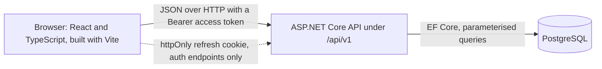

# Testify


Testify is a lightweight test run and defect tracker. You create projects, write test cases, run a selection of them and record Pass, Fail or Blocked, raise defects from failed results, and see a dashboard per project. The API is C# on .NET 10 with PostgreSQL, the web app is React with TypeScript.

Built for an AI-assisted engineering challenge. Every significant decision is recorded in [docs/DECISIONS.md](docs/DECISIONS.md) and the security model in [docs/SECURITY.md](docs/SECURITY.md).

**Status:** every core feature in the brief works end to end when run locally. **The app is not deployed yet.** Only the PostgreSQL database exists on Render. See Deployment and Known Limitations below.

## What you can do

- **Register and sign in.** The access token lives in memory only and lasts 15 minutes. A refresh token in an httpOnly cookie renews it, and it rotates on every use.
- **Projects.** Create a project, list your projects, open one. The creator is the owner. Other users can be invited as editor or viewer (through the API, there is no screen for it yet).
- **Test cases.** Title, preconditions, steps, expected result and priority (Low, Medium, High, Critical). Create, edit and delete.
- **Test runs.** Create a run from a chosen set of test cases, mark each one Pass, Fail, Blocked or Not run, add notes, and watch the pass rate update. A run can be completed and reopened.
- **Defects.** Raise a defect from a failed result on a run. Each has a severity and a status (Open, In Progress, Resolved, Closed) and links back to its test case and run. The Defects tab lists them and filters by status.
- **Dashboard.** Per project: total test cases, runs completed, the pass rate of the latest run, open defects by severity, and the most recent defects.

## Architecture



- The browser talks only to the API. The API address comes from `VITE_API_URL`.
- Every project endpoint checks the signed in user's role on that project (owner, editor or viewer). No token gives 401, an unknown project 404, not enough access 403.
- The pass rate is calculated in one place (`api/Services/RunStats.cs`) so the run list, the run page and the dashboard always agree.
- Writes are recorded in an audit log. Schema changes go through EF Core migrations, which are applied when the API starts.

## Tech stack

| Part | What |
|---|---|
| API | C#, .NET 10, ASP.NET Core controllers, Entity Framework Core |
| Database | PostgreSQL (Render for the shared database) |
| Web | React 19, TypeScript, Vite, react-router v6, plain CSS |
| API tests | xUnit, mostly on the in-memory database, plus 3 tests on a real PostgreSQL in a Testcontainers container |
| Browser tests | Playwright (Chromium), 8 tests, run locally and in CI |
| CI | GitHub Actions |

## Run it locally

You need the .NET 10 SDK, Node 22, and a PostgreSQL database (a local one, or a hosted one such as Render).

**1. Store the API secrets with user secrets.** They live in your user profile, outside the repo, and only load in the Development environment. Replace the placeholders with your own values, and never commit them.

```bash
cd api
dotnet user-secrets set "ConnectionStrings:DefaultConnection" "Host=<host>;Port=5432;Database=<db>;Username=<user>;Password=<password>;SSL Mode=Require"
dotnet user-secrets set "JWT_SECRET" "<a long random string>"
```

**2. Start the API.** Migrations are applied when it starts.

```bash
cd api
dotnet run
```

It listens on `http://localhost:5137`.

**3. Start the web app.** In a second terminal:

```bash
cd frontend
npm ci
npm run dev
```

Open `http://localhost:5173`. The API address comes from `frontend/.env.development`.

Press Ctrl+C in each terminal to stop. If `dotnet run` fails because `Testify.Api.exe` is locked, a previous run was not stopped properly. Restart the computer, or use `dotnet run --no-build`.

## Configuration

Nothing environment-specific is baked into the code. Settings come from configuration.

| Name | Used by | What it is |
|---|---|---|
| `ConnectionStrings__DefaultConnection` | API | The PostgreSQL connection string. The API stops at startup if it is missing. |
| `JWT_SECRET` | API | The key that signs access tokens. |
| `CORS_ALLOWED_ORIGINS` | API | Comma separated list of web app addresses allowed to call the API, never `*`. Development gets `http://localhost:5173` from `api/appsettings.Development.json`. Every other environment must set it. |
| `RATE_LIMIT_PER_MINUTE` | API | Requests allowed per minute per IP address. 100 when it is not set. The browser tests raise it, because they make many requests from one address. |
| `VITE_API_URL` | Web app | The API address, origin only, for example `http://localhost:5137`. Development reads it from `frontend/.env.development`. The app stops at startup if it is missing. In the container it is `/`, the same origin. |
| `API_UPSTREAM` | Web app container | Where nginx forwards `/api/` to, for example `http://api:8080`. Read when the container starts. |

## Tests and CI

The test levels, what each covers and what is not covered are in [docs/TEST_STRATEGY.md](docs/TEST_STRATEGY.md).

**API tests** (81 tests, xUnit: 78 on the in-memory database and 3 on a real PostgreSQL in a container):

```bash
dotnet test api.tests
```

They cover authorization, the audit log, token handling, input validation, CORS, the pass rate rule, run summaries and the dashboard. New API behaviour is written test first. The 3 PostgreSQL tests need Docker: without it they skip on a laptop, and in CI a missing Docker fails the run.

**Web app checks:**

```bash
cd frontend
npx tsc -b
npm run lint
npm run build
```

`tsc -b` checks the app and also the browser test files.

**Browser tests** (8 Playwright tests, Chromium). They run against a throwaway copy of the API that uses an in-memory database, so the real database is never touched. In a fresh terminal, start that API:

```powershell
cd api
$env:ASPNETCORE_ENVIRONMENT = "Test"
$env:ASPNETCORE_URLS = "http://localhost:5137"
$env:JWT_SECRET = "<any long random string, only for this run>"
$env:CORS_ALLOWED_ORIGINS = "http://localhost:5173"
$env:RATE_LIMIT_PER_MINUTE = "100000"
dotnet run --no-launch-profile
```

In a second terminal, run the tests. Playwright starts the web app by itself:

```powershell
cd frontend
npx playwright install chromium
npx playwright test
```

`playwright install` is only needed the first time. When you are done, stop the API with Ctrl+C and close that terminal, so the variables do not linger.

**CI** runs on every pull request and on pushes to `main`. It has four jobs, and all four must pass before a pull request can be merged (`containers` is described under Container images below):

- `api`: a format check and the API tests.
- `frontend`: `npm ci`, lint, then the type-check and build.
- `e2e`: builds the API, starts it in the Test environment, waits for the health endpoint, then runs the 8 Playwright tests. If a test fails, the job prints the API log and keeps the Playwright report for 7 days.

## API

Base path `/api/v1`. Errors from the API's own code look like `{ "error": { "message": "...", "code": "..." }, "status": 400 }`.

| Area | Endpoints |
|---|---|
| Auth | `POST /auth/register`, `POST /auth/login`, `POST /auth/refresh` (reads the refresh cookie), `POST /auth/logout`, `POST /auth/forgot-password`, `POST /auth/reset-password` |
| Projects | `GET /projects`, `POST /projects`, `GET /projects/{id}`, `PUT /projects/{id}`, `DELETE /projects/{id}` |
| Members | `POST /projects/{id}/members/invite`, `DELETE /projects/{id}/members/{userId}` |
| Test cases | `GET /projects/{id}/test-cases`, `POST` the same path, `GET`, `PUT` and `DELETE /projects/{id}/test-cases/{caseId}` |
| Test runs | `GET /projects/{id}/test-runs`, `POST` the same path, `GET`, `PUT` (status) and `DELETE /projects/{id}/test-runs/{runId}` |
| Results | `GET /projects/{id}/test-runs/{runId}/results`, `POST` the same path (add cases), `PATCH /projects/{id}/test-runs/{runId}/results/{resultId}` |
| Defects | `GET /projects/{id}/defects`, `POST` the same path, `GET`, `PUT` (status only) and `DELETE /projects/{id}/defects/{defectId}` |
| Dashboard | `GET /projects/{id}/dashboard` |
| Audit log | `GET /admin/logs` (your own actions and the projects you own) |
| Health | `GET /health` |

The OpenAPI document is served at `/openapi/v1.json`, generated from the controllers, with no sign in needed.

## Deployment

**The app is not deployed.** What exists today:

- A PostgreSQL database on Render (`testify-db-2`). The API applies migrations to it when it starts.
- A CI pipeline that tests and builds, but does not deploy.

Still to do: an infrastructure file (`render.yaml`), the API and web app running over HTTPS, and a documented backup strategy.

## Container images

The API has a multi-stage Dockerfile (`api/Dockerfile`) that runs as a non-root user. It builds from the repo root, and the final image holds only the ASP.NET runtime and the published files. The web app has its own multi-stage Dockerfile (`frontend/Dockerfile`). Node 22 builds the static site with `npm ci`, and the final image is `nginxinc/nginx-unprivileged`, which serves the files on port 8080 as user id 101, with no Node and no source in it. The API address is a build argument (`VITE_API_URL`, no default, so the build fails if it is missing), because Vite bakes it into the bundle at build time. Compose passes `/`, which means the same origin. `frontend/nginx.conf.template` proxies `/api/` to the API (the address comes from `API_UPSTREAM` when the container starts), so the browser only talks to one origin and needs no CORS. Any other path that is not a real file goes to `index.html`, so a direct visit to a client side route works.

The `containers` job in CI builds the API image, starts the database and the API with `docker compose up -d postgres api`, waits for `/api/v1/health` to answer, and checks that a CORS preflight from `http://localhost:3000` is allowed. It then builds the web app image and checks that it does not run as root and contains no Node. Docker Desktop does not start on the development machine, so CI is where this is proven. It then starts the web app together with the database and the API and checks four things: the site is served, a direct visit to a client side route such as `/projects/abc` gets the page (the nginx fallback works), the built JavaScript no longer contains the old API address `http://localhost:5000` (it calls the API on its own origin), and `/api/v1/health` through the web app returns the API's health JSON. It does not click through the app: a browser test against the container stack has not been written.

| Image | Size | Where it was measured |
|---|---|---|
| API (`testify-app-api`) | 356 MB | CI run for PR #70, `docker image ls` |
| Web app (`testify-app-frontend`) | 90.5 MB | the same CI run |
| PostgreSQL (`postgres:15-alpine`, pulled, not built here) | 417 MB | the same CI run |

Compare sizes within one run, not across runs. The same postgres tag showed 292 MB in an earlier CI run and 417 MB in this one, so the number depends on how the runner reports it as well as on the image.

## Known limitations

- Not deployed (see above). The container stack is only checked for serving the page, not clicked through.
- The OpenAPI document has the default title and no description, it does not describe the Bearer token each endpoint needs, and it lists only a 200 response for every endpoint (the API also answers 201, 204, 400, 401, 403 and 404).
- The browser tests use Chromium only. See [docs/TEST_STRATEGY.md](docs/TEST_STRATEGY.md) for what is and is not covered.
- Most API tests use the in-memory database. Only 3 tests run on a real PostgreSQL (a smoke test and negative paging values), so other behaviour that differs between the two is not covered.
- Only the test cases, defects, projects, test runs and audit log lists have a paging bounds check (limit 1 to 200) and a sort order. The test run results list has neither, and only the audit log returns a total count. The framework's own 400 errors use a different shape from the API's.
- Rate limiting is one global limit per IP. There is no stricter limit on sign in, and behind a proxy every client shares the proxy's address.
- CORS allows any method and header from the allowed origins.
- Inviting a member has no screen, the emailed link goes nowhere, and emails are mocked and written to the server log. There is no endpoint to list a project's members.
- A defect's title, description and severity cannot be edited after it is raised, and nothing sets its resolved date.
- Lint reports about ten warnings (React hook dependencies). They are warnings, not errors.
- Findings from `npm audit` are not triaged, and Dependabot is not configured.
- More security limitations are listed in [docs/SECURITY.md](docs/SECURITY.md).

## Documentation

- [docs/DECISIONS.md](docs/DECISIONS.md): every significant decision and what was learned
- [docs/SECURITY.md](docs/SECURITY.md): the security model and its limits
- [docs/TEST_STRATEGY.md](docs/TEST_STRATEGY.md): what is tested at each level, and what is not
- [docs/CODE_REVIEW.md](docs/CODE_REVIEW.md): the code review this work follows
- [docs/ai-engineering-challenge-brief.md](docs/ai-engineering-challenge-brief.md): the challenge brief
- The planning documents (schema, endpoints, components, Docker) were written before coding. Where they differ from the code, the code is the source of truth.

**Last updated:** November 1, 2026