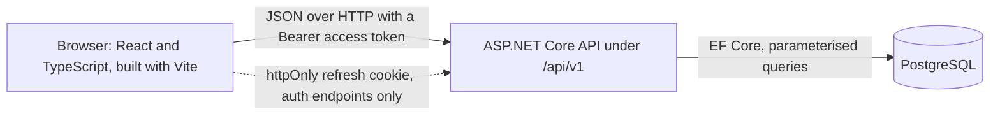

# Testify


Testify is a lightweight test run and defect tracker. You create projects, write test cases, run a selection of them and record Pass, Fail or Blocked, raise defects from failed results, and see a dashboard per project. The API is C# on .NET 10 with PostgreSQL, the web app is React with TypeScript.

Built for an AI-assisted engineering challenge. Every significant decision is recorded in [docs/DECISIONS.md](docs/DECISIONS.md) and the security model in [docs/SECURITY.md](docs/SECURITY.md).

**Status:** every core feature in the brief works end to end when run locally. **The app is not deployed yet.** Only the PostgreSQL database exists on Render. See Deployment and Known Limitations below.

## What you can do

- **Register and sign in.** The access token lives in memory only and lasts 15 minutes. A refresh token in an httpOnly cookie renews it, and it rotates on every use.
- **Projects.** Create a project, list your projects, open one. The creator is the owner. Other users can be invited as editor or viewer (through the API, there is no screen for it yet).
- **Test cases.** Title, preconditions, steps, expected result and priority (Low, Medium, High, Critical). Create, edit and delete.
- **Test runs.** Create a run from a chosen set of test cases, mark each one Pass, Fail, Blocked or Not run, add notes, and watch the pass rate update. A run can be completed and reopened.
- **Defects.** Raise a defect from a failed result on a run. Each has a severity and a status (Open, In Progress, Resolved, Closed) and links back to its test case and run. The Defects tab lists them and filters by status.
- **Dashboard.** Per project: total test cases, runs completed, the pass rate of the latest run, open defects by severity, and the most recent defects.

## Architecture



- The browser talks only to the API. The API address comes from `VITE_API_URL`.
- Every project endpoint checks the signed in user's role on that project (owner, editor or viewer). No token gives 401, an unknown project 404, not enough access 403.
- The pass rate is calculated in one place (`api/Services/RunStats.cs`) so the run list, the run page and the dashboard always agree.
- Writes are recorded in an audit log. Schema changes go through EF Core migrations, which are applied when the API starts.

## Tech stack

| Part | What |
|---|---|
| API | C#, .NET 10, ASP.NET Core controllers, Entity Framework Core |
| Database | PostgreSQL (Render for the shared database) |
| Web | React 19, TypeScript, Vite, react-router v6, plain CSS |
| API tests | xUnit with the in-memory database |
| Browser tests | Playwright (out of date, see Known Limitations) |
| CI | GitHub Actions |

## Run it locally

You need the .NET 10 SDK, Node 22, and a PostgreSQL database (a local one, or a hosted one such as Render).

**1. Store the API secrets with user secrets.** They live in your user profile, outside the repo, and only load in the Development environment. Replace the placeholders with your own values, and never commit them.

```bash
cd api
dotnet user-secrets set "ConnectionStrings:DefaultConnection" "Host=<host>;Port=5432;Database=<db>;Username=<user>;Password=<password>;SSL Mode=Require"
dotnet user-secrets set "JWT_SECRET" "<a long random string>"
```

**2. Start the API.** Migrations are applied when it starts.

```bash
cd api
dotnet run
```

It listens on `http://localhost:5137`.

**3. Start the web app.** In a second terminal:

```bash
cd frontend
npm ci
npm run dev
```

Open `http://localhost:5173`. The API address comes from `frontend/.env.development`.

Press Ctrl+C in each terminal to stop. If `dotnet run` fails because `Testify.Api.exe` is locked, a previous run was not stopped properly. Restart the computer, or use `dotnet run --no-build`.

## Configuration

Nothing environment-specific is baked into the code. Settings come from configuration.

| Name | Used by | What it is |
|---|---|---|
| `ConnectionStrings__DefaultConnection` | API | The PostgreSQL connection string. The API stops at startup if it is missing. |
| `JWT_SECRET` | API | The key that signs access tokens. |
| `CORS_ALLOWED_ORIGINS` | API | Comma separated list of web app addresses allowed to call the API, never `*`. Development gets `http://localhost:5173` from `api/appsettings.Development.json`. Every other environment must set it. |
| `VITE_API_URL` | Web app | The API address, origin only, for example `http://localhost:5137`. Development reads it from `frontend/.env.development`. The app stops at startup if it is missing. |

## Tests and CI

**API tests** (72 tests, xUnit, in-memory database):

```bash
dotnet test api.tests
```

They cover authorization, the audit log, token handling, input validation, CORS, the pass rate rule, run summaries and the dashboard. New API behaviour is written test first.

**Web app checks:**

```bash
cd frontend
npx tsc -b
npm run lint
npm run build
```

**CI** runs on every pull request and on pushes to `main`: a format check, the API tests, then for the web app `npm ci`, lint, type-check and build. Both jobs (`api` and `frontend`) must pass before a pull request can be merged.

## API

Base path `/api/v1`. Errors from the API's own code look like `{ "error": { "message": "...", "code": "..." }, "status": 400 }`.

| Area | Endpoints |
|---|---|
| Auth | `POST /auth/register`, `POST /auth/login`, `POST /auth/refresh` (reads the refresh cookie), `POST /auth/logout`, `POST /auth/forgot-password`, `POST /auth/reset-password` |
| Projects | `GET /projects`, `POST /projects`, `GET /projects/{id}`, `PUT /projects/{id}`, `DELETE /projects/{id}` |
| Members | `POST /projects/{id}/members/invite`, `DELETE /projects/{id}/members/{userId}` |
| Test cases | `GET /projects/{id}/test-cases`, `POST` the same path, `GET`, `PUT` and `DELETE /projects/{id}/test-cases/{caseId}` |
| Test runs | `GET /projects/{id}/test-runs`, `POST` the same path, `GET`, `PUT` (status) and `DELETE /projects/{id}/test-runs/{runId}` |
| Results | `GET /projects/{id}/test-runs/{runId}/results`, `POST` the same path (add cases), `PATCH /projects/{id}/test-runs/{runId}/results/{resultId}` |
| Defects | `GET /projects/{id}/defects`, `POST` the same path, `GET`, `PUT` (status only) and `DELETE /projects/{id}/defects/{defectId}` |
| Dashboard | `GET /projects/{id}/dashboard` |
| Audit log | `GET /admin/logs` (your own actions and the projects you own) |
| Health | `GET /health` |

An OpenAPI specification is not served yet.

## Deployment

**The app is not deployed.** What exists today:

- A PostgreSQL database on Render (`testify-db-2`). The API applies migrations to it when it starts.
- A CI pipeline that tests and builds, but does not deploy.

Still to do: a production frontend image, a CI job that builds both images, an infrastructure file (`render.yaml`), the API and web app running over HTTPS, and a documented backup strategy.

## Container images

The API has a multi-stage Dockerfile that runs as a non-root user. The web app's Dockerfile is not production shaped yet (it runs the Vite dev server). `docker compose up` has not been proven end to end: Docker Desktop does not start on the development machine, so this is to be proven in CI. **Image sizes are not recorded yet**, because the images have not been built.

## Known limitations

- Not deployed, and the container setup is not proven (see above).
- The OpenAPI specification is not served.
- The Playwright tests in `frontend/tests/e2e` are out of date and do not run in CI. They need rewriting for the register rules, the create project form and the run page, and there is no browser test for executing a run yet.
- The API tests use the in-memory database, not a real PostgreSQL. Behaviour that differs between the two is not covered.
- Lists have no maximum page size and no total count, and the test cases list has no sort order. The framework's own 400 errors use a different shape from the API's.
- Rate limiting is one global limit per IP. There is no stricter limit on sign in, and behind a proxy every client shares the proxy's address.
- CORS allows any method and header from the allowed origins.
- Inviting a member has no screen, the emailed link goes nowhere, and emails are mocked and written to the server log. There is no endpoint to list a project's members.
- A defect's title, description and severity cannot be edited after it is raised, and nothing sets its resolved date.
- Lint reports about ten warnings (React hook dependencies). They are warnings, not errors.
- `Microsoft.OpenApi` 2.0.0 has a known high severity advisory (build warning NU1903), and findings from `npm audit` are not triaged. Dependabot is not configured.
- More security limitations are listed in [docs/SECURITY.md](docs/SECURITY.md).

## Documentation

- [docs/DECISIONS.md](docs/DECISIONS.md): every significant decision and what was learned
- [docs/SECURITY.md](docs/SECURITY.md): the security model and its limits
- [docs/CODE_REVIEW.md](docs/CODE_REVIEW.md): the code review this work follows
- [docs/ai-engineering-challenge-brief.md](docs/ai-engineering-challenge-brief.md): the challenge brief
- The planning documents (schema, endpoints, components, Docker) were written before coding. Where they differ from the code, the code is the source of truth.

**Last updated:** October 31, 2026